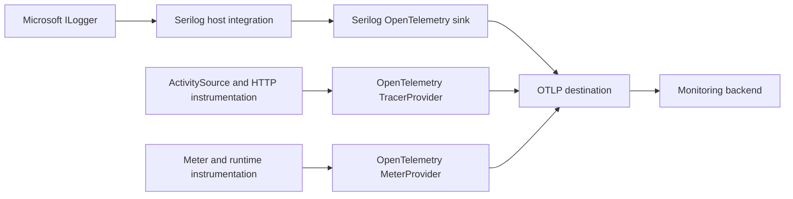

# Observability and Configuration Design

Status: requirements confirmed in D16-D19; technical design, not implemented
runtime behavior. D13/D20 and general engineering review remain open. This
supplements [PLAN.md](PLAN.md) and [DECISIONS.md](DECISIONS.md).

## 1. Required pipelines and ownership



The destination is a Collector or backend, pending D20. Logs, traces, and
metrics are required in the autoscaler. Invalid exporter configuration fails
startup. A temporary destination outage must not interrupt jobs or create
an unbounded queue.

Reusable packages accept `Microsoft.Extensions.Logging.ILogger<T>` and emit
`ActivitySource`/`Meter` signals; they do not initialize SDK providers or
require Serilog. The executable owns logger/SDK composition, following the
[OpenTelemetry app/library boundary](https://opentelemetry.io/docs/languages/dotnet/instrumentation/).

Use Serilog.Extensions.Hosting as the ILogger bridge, retaining message
templates, categories, and scopes. Serilog.Sinks.OpenTelemetry exports
LogRecords and maps the current Activity's trace/span IDs. Set matching
resource attributes explicitly. Do not also export these logs via an OTel
ILogger provider, or send Activity-derived spans through the sink when the
SDK already exports them. Use signal-specific SDK trace/metric exporters to
avoid accidental second logging export registration.
[Serilog hosting](https://github.com/serilog/serilog-extensions-hosting),
[Serilog sink](https://github.com/serilog/serilog-sinks-opentelemetry).

Composition packages: Microsoft.Extensions.Logging.Abstractions in libraries;
Serilog.Extensions.Hosting, Serilog.Sinks.OpenTelemetry,
OpenTelemetry.Extensions.Hosting, OpenTelemetry.Exporter.OpenTelemetryProtocol,
and relevant HTTP/runtime instrumentation in the executable. Add ASP.NET Core
instrumentation only if the endpoint host uses it. Resolve released .NET
10-compatible versions and exact APIs in M1.

## 2. Resources, tracing, and log correlation

Resolve one identity for both the Serilog sink and SDK providers:
`service.name`, `service.namespace`, `service.version`, `service.instance.id`,
and `deployment.environment.name`. Process instance identity differs from
stable resource-ownership identity. Follow
[resource conventions](https://opentelemetry.io/docs/specs/semconv/resource/).

Proposed ActivitySources: ScaleSet.Client, ScaleSet.Listener, ScaleSet.Hosting,
and provider-specific sources. Register exact names/versions. Create operation
spans, not one indefinitely open listener span or one span per method. Finish
them on all paths; distinguish normal cancellation/empty polls from failure.
Use validated parent-based sampling, always-on in acceptance tests, with a
documented tunable production rate. Required instrumentation does not imply
storing every production span. Follow
[tracing best practices](https://opentelemetry.io/docs/languages/dotnet/traces/best-practices/).

Use supported HTTP instrumentation and
[HTTP semantic conventions](https://opentelemetry.io/docs/specs/semconv/http/http-spans/).
Custom business attributes use a `scaleset.*` namespace. The inspected GitHub
message schema contains no workflow trace parent; use actual supported
context or controller operation context/links, without inventing a shared
trace with the workflow. Keep successful long polls distinct from processing
spans and avoid excessive volume from healthy empty polls.

Logs inside a span must carry its matching TraceId/SpanId fields. Outside an
Activity, logs remain valid without fabricated IDs. Follow the
[log data model](https://opentelemetry.io/docs/specs/otel/logs/data-model/).
Log scale-set/provider/operation and safe GitHub/Actions correlation IDs.
Redact credentials, JIT payloads, exporter-auth/Authorization headers, and
sensitive configuration from both messages and serialized exceptions.

## 3. Required instrumentation inventory

These are proposed application signals, not published domain standards.

| Operation | Trace/log evidence | Metric evidence |
|---|---|---|
| Auth exchange/refresh | Safe refresh/failure spans | Operations/failures/duration |
| Queue poll | Poll and batch-processing correlation; empty=normal | Poll outcomes/duration |
| Acquire/ack/session | Request/callback sequence | Operations/duration/failures |
| Scaling/reconciliation | Demand, policy, reservations, outcome | Assigned jobs, desired runners, reserved/occupied capacity |
| Provider lifecycle | Stable create/start/inspect/remove operations | Duration/outcome/startup/cleanup failures |
| Runner transitions | Replay and recovery evidence | Current runners by finite lifecycle state |
| Drain/restart | Entry/deadline/remaining resources | Drain duration/protected runners/recovery failures |
| Process/export | Startup/exit/export diagnostics | Supported runtime signals/export-failure diagnostics |

Proposed metrics include observable gauges for assigned jobs, desired/current
runners, and reserved capacity; counters for operations/failures; and duration
histograms in seconds. Keep long-lived meters/instruments, using IMeterFactory
when DI composes them. Network export never runs synchronously on a metric
recording or job-processing path.

Views define units, aggregations/buckets, bounded attributes, and cardinality
limits. Allowed dimensions: configured scale-set key, provider, operation,
finite runner state, bounded outcome/error category. Job/runner/trace/span IDs,
full URLs, arbitrary error text, and secret paths are excluded. Use exemplars
for metric/trace correlation where supported. Test overflow and hot-path
allocations against [.NET metrics best practices](https://opentelemetry.io/docs/languages/dotnet/metrics/best-practices/).

## 4. Phase-one environment schema

Environment variables override code defaults. Configure the host explicitly
to exclude implicit appsettings JSON/command-line configuration providers.
CLI arguments choose commands/action targets; public library options can
still be constructed in code by consumers.

Proposed prefix: `SCALESET__`; `__` separates nested keys and numeric segments
index lists. Use CLR option-member spellings without introducing extra
single underscores, so case-insensitive binding remains predictable. Validate
all arrays, required references, duplicate targets, ranges, and telemetry
settings before side effects. See Microsoft's
[environment configuration provider](https://learn.microsoft.com/en-us/dotnet/core/extensions/configuration-providers).

Illustrative schema, not an implemented deployment:

```text
SCALESET__CONTROLLER__STATEDIRECTORY=/state
SCALESET__SCALESETS__0__KEY=builds
SCALESET__SCALESETS__0__GITHUBURL=https://github.com/example-org
SCALESET__SCALESETS__0__NAME=build-runners
SCALESET__SCALESETS__0__CREDENTIALSREF=GitHubApp
SCALESET__SCALESETS__0__SCALING__POLICY=SpareCapacity
SCALESET__SCALESETS__0__SCALING__MINRUNNERS=0
SCALESET__SCALESETS__0__SCALING__MAXRUNNERS=10
SCALESET__CREDENTIALS__GITHUBAPP__CLIENTID=<provided-at-deployment>
SCALESET__CREDENTIALS__GITHUBAPP__INSTALLATIONID=<provided-at-deployment>
SCALESET__CREDENTIALS__GITHUBAPP__PRIVATEKEYPEM=<secret-injected-at-runtime>
OTEL_SERVICE_NAME=scaleset-autoscaler
OTEL_RESOURCE_ATTRIBUTES=service.namespace=scaleset,deployment.environment.name=development
OTEL_EXPORTER_OTLP_PROTOCOL=http/protobuf
OTEL_EXPORTER_OTLP_ENDPOINT=http://otel-collector:4318
```

The Collector hostname is illustrative pending D20. Standard `OTEL_*` settings
configure endpoints/protocols, resource identity, headers, and sampling where
supported. Explicitly bind/adapt any unsupported settings; verify effective
SDK and sink settings instead of assuming identical environment support.
Common and signal-specific HTTP endpoint paths differ; follow
[OTLP exporter configuration](https://opentelemetry.io/docs/languages/sdk-configuration/otlp-exporter/).
Product deployment has no feature switch that silently disables tracing/metrics.

Phase-one credentials can be injected into the controller environment.
Examples use placeholders only; never dump the environment/config or pass
controller credentials to runners. File references can be added if requested,
but mounted credential files are not a required configuration mechanism.

## 5. Phase-two runtime AWS providers

Confirmed D18-D19: use Parameter Store for settings and Secrets Manager for
credentials, loaded by runtime providers with caching/credential refresh.
Keep AWS dependencies in ScaleSet.Configuration.Aws, outside Client/Listener.
Environment supplies bootstrap region, settings prefix, credential references,
and deployment overrides. Resolve AWS identity through the workload role.

Proposed operational precedence: code defaults < validated Parameter Store
snapshot < explicit non-secret environment overrides. Bind operational settings
once for each controller startup; require restart for changes initially.
Environment chooses credential references in AWS deployments; Secrets Manager
resolves values. Reject ambiguous competing credential sources and scope
permissions to configured paths, secrets, and KMS keys.

Cache credentials by secret/version and refresh on a configurable interval
with bounded backoff. Validate and atomically publish a new credential
generation; new auth operations use generation-bound caches so a late response
cannot overwrite newer credentials. Define admin/installation-token cache
invalidation while preserving in-flight request semantics and runner jobs.
Use complete snapshots, never partially update an active configuration.
AWS provides [a .NET configuration-provider example](https://aws.amazon.com/blogs/dotnet/dynamic-configuration-updates-in-net-using-parameter-store-and-secrets-manager/).
Its operational hot reload is not enabled by this plan.

Required-source failure stops startup before acquisition. Later transient
refresh failures expose degraded health and bounded retry, retaining the
last valid snapshot only within the configured validity/credential-expiry
policy. Do not persist resolved credentials in recovery state or print them
in provider diagnostics.

Parameter Store can reference Secrets Manager; its own stored secrets do not
provide automatic rotation. Preserve the distinct roles of these services.
[AWS integration documentation](https://docs.aws.amazon.com/secretsmanager/latest/userguide/integrating_parameterstore.html).
ECS environment injection alone captures startup values and does not refresh
running tasks after rotation; it cannot substitute for the confirmed runtime
credential-refresh requirement.
[AWS ECS guidance](https://repost.aws/knowledge-center/ecs-manage-secrets-access-keys).

## 6. Export lifecycle and release gates

Initialize telemetry early, with bootstrap logging for failures before host
composition. Register exact sources/meters, one trace provider and one metric
provider, and matching Serilog resources. Batch exports with bounded memory,
retry, and timeout behavior. A destination outage is observable degradation,
not a reason to stop runner jobs.

After D12 drain/persistence/session closure, flush and dispose logging/telemetry
within a separate bounded budget. Include it in deployment stop grace; an
unavailable destination must not cause indefinite shutdown or forced runner
cleanup. Delivery is not guaranteed after a hard process/host kill.

Required acceptance evidence:

1. A test OTLP receiver sees logs, completed spans, and metrics from startup,
   poll/acquire/provision/completion/recovery/drain.
2. ILogger log IDs match their exported span, and resources agree across
   signals; no duplicate logger/span export pipeline exists.
3. Empty 202 polls and normal cancellation have intended non-error semantics;
   actual failures carry safe status/domain classification.
4. Many synthetic job/resource IDs cannot create unbounded metric dimensions;
   units/state gauges/counters/overflow behavior are correct.
5. Secret/JIT/header sentinel values never appear in any captured signal,
   exception preview, resource, or configuration diagnostics.
6. Export outage/backpressure and final flush stay bounded while job handling
   and runner preservation remain correct.
7. Environment tests cover binding, lists/references, invalid values,
   precedence, redaction, and per-signal endpoint configuration.
8. AWS tests cover denied/missing sources, cached snapshots, credential
   rotation during auth/drain, generation races, and restart-based settings.

Use synthetic secrets and local fixtures for ordinary tests. No real AWS
secret values enter planning documents, agent output, or CI logs.
