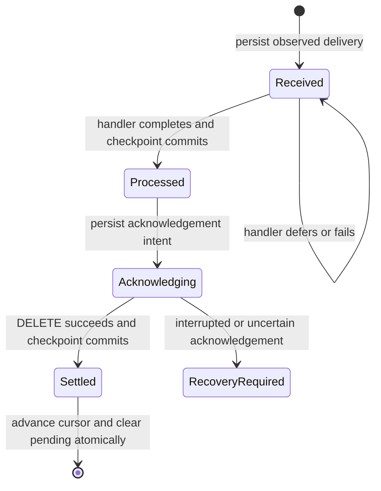

# Durable and externally controlled listener execution

Status: **planned; not implemented**. Prepared 2026-11-24 (Australia/Sydney).
Source baseline: `36831ad` in `scaleset.NET`. This proposal extends
`Knightfall.ScaleSet.Listener` using the existing `ScaleSet.*` namespaces and
`.NET 10` target. It does not authorize AWS deployment or change the existing
Docker runtime's persistence model.

Tracking: [#58 — Add checkpointed, stepwise listener execution with external
operation authorization](https://github.com/knightfall/scaleset.NET/issues/58).
Implementation issues are linked under LE1–LE5 below. The umbrella issue
contains the planning baseline so development does not depend on this document
being published first. [#46](https://github.com/knightfall/scaleset.NET/issues/46)
is already closed and its session ownership, telemetry discovery, and Hosting
recovery work is part of the baseline.

## 1. Problem and intended behavior

Applications can currently use `ScaleSetListener.RunAsync` to poll an initialized
session, process a delivery, and acknowledge successful handling. An external
controller additionally needs to persist deliveries before side effects,
resume unfinished processing, stop when ownership expires, and interleave
listener execution with its own reconciliation work.

For example, a controller receives message 42, commits its job reservations,
and crashes before acknowledging it. The next authorized execution must read
the checkpoint, distinguish unfinished processing from acknowledgement work,
and avoid acquiring the same jobs again. It must not poll past the unresolved
delivery or send its acknowledgement to a replacement session.

The feature supplies reusable execution ordering and extension contracts.
Applications supply storage, ownership policy, admission accounting, and
session supervision. A database-backed controller and a simpler process-local
consumer should both be able to use the public package without an AWS dependency.

### Baseline inspected

| Source | Current contract and implication |
| --- | --- |
| [ScaleSetListener](../../src/ScaleSet.Listener/ScaleSetListener.cs) | One active `RunAsync` per instance; initial statistics precede polling; each run starts its cursor at zero; successful callbacks permit acknowledgement. |
| [Listener options](../../src/ScaleSet.Listener/ScaleSetListenerOptions.cs) | Scale-set ID, mutable advertised capacity through `SetMaxRunners`, and a finite acknowledgement timeout. No durable state or external ownership contract. |
| [Message handler](../../src/ScaleSet.Listener/IScaleSetMessageHandler.cs) | Initial synthetic message, real messages, and null polls share one callback; successful completion permits acknowledgement. |
| [Session interfaces](../../src/ScaleSet.Client/IMessageSessionClient.cs) | Queue operations already accept cancellation. `IMessageSession` separately owns explicit closure. Do not add members to either interface for this feature. |
| [Concrete session client](../../src/ScaleSet.Client/MessageSessionClient.cs) | Coordinates queue-token refresh, including one retry after a queue 401; exposes no public attachment of a persisted remote session. |
| [Hosting supervision](../../src/ScaleSet.Hosting/Runtime/ScaleSetSessionRecovery.cs) | Owns bounded transient recovery and closes the previous session before reconnecting. This behavior must not move into the reusable Listener. |
| [Listener tests](../../tests/ScaleSet.Listener.Tests/ScaleSetListenerTests.cs) and [transport tests](../../tests/ScaleSet.Listener.Tests/ListenerTransportIntegrationTests.cs) | Preserve initial/empty callbacks, callback-before-ack, dynamic capacity, failure propagation, concurrency exclusion, and acknowledgement surviving graceful host cancellation. |

## 2. Scope and ownership

| Component | Owns |
| --- | --- |
| Listener execution | Serialized poll/process/ack/checkpoint ordering, bounded operations, explicit yield results, and protocol telemetry. |
| Checkpoint store supplied by consumer | Consistent checkpoint reads, atomic compare-and-write, durable payload storage, and enforcement of the consumer's ownership fence on writes. |
| Execution policy supplied by consumer | Whether an operation may begin, its ownership cancellation signal and deadline, and current advertised capacity before a poll. |
| Delivery handler supplied by consumer | Deduplicated business effects, job acquisition, post-poll admission calculation, durable reservations, and completion versus defer. |
| Application supervisor | Session creation/closure/replacement, credentials, shared rate-limit scheduling, reconciliation, recovery decisions, and scheduling the next step. |
| Client | Existing transport, protocol parsing, retry configuration, queue authentication, and coordinated queue-token refresh. |

Included: an opt-in stepwise driver, a session-bound checkpoint contract,
persist-before-handle ordering, explicit processing outcomes, operation
authorization, cancellation/deadline composition, compatibility tests, and
package consumer documentation and examples.

Excluded: DynamoDB/SQL implementations, distributed leader election, credential
storage, automatic session recreation, automatic job-acquisition retries, AWS
providers, a new Hosting persistence abstraction, and changes to GitHub wire
semantics. Do not promise exactly-once business execution or remote fencing
merely because a cancellation token is cancelled.

## 3. Public API contract

Keep the legacy Listener and Client interfaces intact. The advanced driver
binds one session and one caller-owned execution incarnation. All declarations
below are in `ScaleSet.Listener`. LE2 implements these contracts internally;
LE3 exposes them with the operation enforcement in §6.

```csharp
public sealed class ScaleSetListenerPump
{
    public ScaleSetListenerPump(
        IMessageSessionClient session,
        ScaleSetListenerPumpOptions options,
        IScaleSetListenerCheckpointStore checkpoints,
        IScaleSetListenerDeliveryHandler handler,
        IScaleSetListenerExecutionPolicy policy,
        TimeProvider? timeProvider = null);

    public Task<ScaleSetListenerStepResult> StepAsync(
        CancellationToken stoppingToken = default);
}

public sealed record ScaleSetListenerSessionKey(string Scope, long ScaleSetId, Guid SessionId);

public sealed record ScaleSetListenerPumpOptions(
    ScaleSetListenerSessionKey SessionKey, CancellationToken OwnershipLost)
{
    public TimeSpan PollTimeout { get; init; } = TimeSpan.FromMinutes(2);
    public TimeSpan ProcessingTimeout { get; init; } = TimeSpan.FromMinutes(1);
    public TimeSpan CheckpointTimeout { get; init; } = TimeSpan.FromSeconds(10);
    public TimeSpan AcknowledgmentTimeout { get; init; } = TimeSpan.FromSeconds(30);
}

public enum ScaleSetListenerDeliveryKind { InitialStatistics, Message, EmptyPoll }
public enum ScaleSetListenerDeliveryDisposition { Completed, Deferred }
public enum ScaleSetListenerPendingPhase { Received, Processed, Acknowledging }

public sealed record ScaleSetListenerDelivery
{
    public ScaleSetListenerDelivery(
        ScaleSetListenerSessionKey sessionKey, ScaleSetListenerDeliveryKind kind,
        DateTimeOffset observedAt, RunnerScaleSetMessage? message = null,
        RunnerScaleSetStatistic? initialStatistics = null);

    public ScaleSetListenerSessionKey SessionKey { get; }
    public ScaleSetListenerDeliveryKind Kind { get; }
    public DateTimeOffset ObservedAt { get; }
    public RunnerScaleSetMessage? Message { get; }
    public RunnerScaleSetStatistic? InitialStatistics { get; }
    public bool IsReplay { get; }
}

public sealed record ScaleSetListenerPendingDelivery(
    ScaleSetListenerDelivery Delivery, ScaleSetListenerPendingPhase Phase);

public sealed record ScaleSetListenerCheckpoint(
    ScaleSetListenerSessionKey SessionKey, int SchemaVersion, long Revision,
    Guid TransitionId, bool InitialStatisticsCompleted,
    long? LastAcknowledgedMessageId, ScaleSetListenerPendingDelivery? Pending);

public enum ScaleSetListenerCheckpointWriteResult { Committed, Conflict }

public interface IScaleSetListenerCheckpointStore
{
    Task<ScaleSetListenerCheckpoint?> ReadAsync(
        ScaleSetListenerSessionKey key, CancellationToken cancellationToken);
    Task<ScaleSetListenerCheckpointWriteResult> WriteAsync(
        ScaleSetListenerSessionKey key, long? expectedRevision,
        ScaleSetListenerCheckpoint checkpoint, CancellationToken cancellationToken);
}

public interface IScaleSetListenerDeliveryHandler
{
    Task<ScaleSetListenerDeliveryDisposition> HandleAsync(
        ScaleSetListenerDelivery delivery, CancellationToken cancellationToken);
}

public enum ScaleSetListenerOperation
{
    ReadCheckpoint, PersistReceived, Poll, HandleDelivery, PersistProcessed,
    PersistAcknowledging, Acknowledge, PersistSettled
}

public sealed record ScaleSetListenerOperationContext(
    ScaleSetListenerSessionKey SessionKey, ScaleSetListenerOperation Operation,
    long? Revision, ScaleSetListenerDeliveryKind? DeliveryKind, long? MessageId);

public sealed class ScaleSetListenerAuthorization
{
    public DateTimeOffset? ValidUntil { get; }
    public CancellationToken OwnershipLost { get; }
    public int? MaxCapacity { get; }
    public DateTimeOffset? RetryAt { get; }

    public static ScaleSetListenerAuthorization Allow(
        DateTimeOffset validUntil, int? maxCapacity = null, CancellationToken ownershipLost = default);
    public static ScaleSetListenerAuthorization Defer(DateTimeOffset? retryAt = null);
}

public interface IScaleSetListenerExecutionPolicy
{
    Task<ScaleSetListenerAuthorization> AuthorizeAsync(
        ScaleSetListenerOperationContext context, CancellationToken cancellationToken);
}

public enum ScaleSetListenerStepStatus
{
    Initialized, EmptyPoll, MessageAcknowledged, Deferred, RecoveryRequired, CheckpointConflict
}

public sealed record ScaleSetListenerStepResult(
    ScaleSetListenerStepStatus Status, long? MessageId = null,
    ScaleSetListenerPendingPhase? PendingPhase = null, DateTimeOffset? RetryAt = null);
```

`PersistProcessed` completes initial statistics as well as recording a
processed real message. Authorization revision is the checkpoint revision
observed by the pump, or null before a read or initial creation. Only poll
permits supply capacity. A deferral can carry an optional scheduling hint.
Use a single fixed ownership token in the pump options and all allowed
permits, so ownership loss reaches policy evaluation before a permit exists.
A different token is an invalid permit. The store and ledger still bind
their actual conditional writes to the same incarnation.

Completion promises durable or safely recoverable business effects.
`IsReplay` describes the handler invocation and is excluded from persisted
state. `CheckpointConflict` means this pump must stop. Resume only under
current ownership with a fresh pump reading a consistent checkpoint.
`RecoveryRequired` means the supervisor must resolve uncertain acknowledgement
before the old session can proceed. The activity source carries bounded
operation and outcome values. No logger collaborator is needed by the pump.

The pump does not close or dispose caller-owned sessions, stores, policies,
handlers, or clocks. It disposes its own timers and linked token
sources. Concurrent or reentrant `StepAsync` calls fail immediately without
interrupting the active call. An application must never drive the same remote
session through multiple pumps or through a pump and `RunAsync` simultaneously;
per-instance exclusion is not distributed session ownership.

## 4. Checkpoint and session identity

The checkpoint key consists of a caller-supplied stable scope key, a positive
scale-set ID, and the exact nonempty session GUID. The scope key distinguishes
GitHub host and repository/organization/enterprise target; a numeric scale-set
ID alone is insufficient. Validate available session identity against the key,
and reject a change of session GUID between operations. A token refresh that
preserves the session GUID does not reset the checkpoint.

A checkpoint contains:

- Schema version 1, revision starting at 1, and a unique nonempty transition
  GUID generated by the writer and preserved exactly by the store.
- Whether the initial-statistics delivery has been completed.
- Nullable `LastAcknowledgedMessageId`: absence differs from acknowledgement
  of message `0`. Real message IDs are 64-bit and nonnegative; initial
  statistics are a distinct delivery kind, not a real queue message.
- At most one pending initial-statistics or real-message delivery, including
  its immutable payload snapshot, original observation time, and phase.
- Pending real-message phase: `Received`, `Processed`, or `Acknowledging`.

Initial statistics may be pending only while initialization is incomplete;
real messages may be pending only after it completes. `Processed` and
`Acknowledging` apply only to real messages. Validate that the payload identity
matches the pending identity and that confirmed cursor history never regresses.
A duplicate pending message at or below the confirmed cursor is valid and
must not be rejected solely for that reason. Empty polls are never pending.

Validate the key before callbacks. Scope is a nonblank, control-free
configuration key of at most 256 characters, compared ordinally. Compare
the exact session GUID and any positive scale-set ID reported in the session
snapshot. The caller supplies and verifies the scope, which the session
interface cannot independently establish. Revision 1 is the initial receipt.
An uninitialized checkpoint can only hold that receipt, with revision 1 and
no confirmed cursor. An initialized checkpoint starts at revision 2. Reject
unknown schema versions, invalid discriminators, invalid pending shapes,
negative cursors, missing timestamps, and transition IDs of all zeros.
Reject revision overflow before a write. Validate durable state before any
handler or queue effect. Adapters must explicitly migrate older schemas
offline under current ownership before handing them to the pump.

Persist only typed delivery data. Initial statistics carry no message or ID,
real messages carry a nonnegative ID, and empty observations carry neither
message nor statistics. Snapshot recognized collections and their nested
labels into read-only arrays. Strip the acquisition URL from available jobs;
the handler acquires by request ID. Validate nonnegative statistics, a total
of at most 16,384 job records, at most 1,024 labels per job, and a total text
budget of 1,048,576 UTF-16 code units across message fields and labels. Reject
null collection entries and unbounded input. Limits are Listener safeguards,
not service guarantees or an adapter's encoded-byte limit. The pump does
not serialize the session or designate the wire serializer as a checkpoint
format. Adapters must check encoded input size before deserializing and may
chunk payloads while exposing one atomic logical checkpoint.

Reads return the latest committed checkpoint, or null for an absent key.
Writes compare the exact previous revision (null means create only) and
the consumer's ownership condition in one atomic mutation. `Committed`
confirms the entire transition. `Conflict` confirms it did not apply and
terminates this pump's use of the checkpoint. If a write throws, its
response may be uncertain. The active step propagates the original failure.
A subsequent authorized read must match the exact intended transition
(including its transition ID and payload), or the exact prior checkpoint.
A match to the prior checkpoint permits retry of the identical conditional
write. A different record requires conflict handling, even at a higher
revision. No automatic overwrite or partial cursor/pending update is valid.

A normally completed real delivery costs four logical checkpoint writes:
receipt, processed, ack intent, and settlement. At N delivered batches per
second the adapter plans for 4N conditional write transactions per second,
or 345,600N per day, plus reads, initial receipts/completions, retries,
reconciliation, and the application effect ledger. For a single checkpoint
item and a separate lease condition, budget two transactional write units
per started KiB of checkpoint and two transactional read units per started
4 KiB of lease item for each transaction. The receipt can atomically include
a separate sanitized inbox item and check the lease. The handler commits
admission and per-request effects under the same fence before reporting
completion. Those commits are independently replayable. Keep the hot
checkpoint compact and use atomic payload references for larger batches.
The adapter must account for DynamoDB item, transaction size, distinct-item
limits, and consistent reads. [DynamoDB transaction limits and capacity](https://docs.aws.amazon.com/amazondynamodb/latest/developerguide/transaction-apis.html)

The pump takes defensive snapshots of delivery collections before persistence
and processing; mutable `IReadOnlyList` implementations must not let a handler
alter the saved message. Replaying a saved delivery preserves its observation
timestamp; it does not refresh the age of demand statistics. A newly received
duplicate can carry a newer statistics observation. The application merges
those facts monotonically and deduplicates business effects separately.

### Remote session recovery is a separate boundary

The concrete `ScaleSetClient.CreateMessageSessionAsync` opens a session with
POST and returns the caller-owned `MessageSessionClient`. Its constructor
is internal. The queue-401 path PATCHes that object's current session GUID
and retries the same queue operation once with refreshed credentials. The
baseline parser validates that the returned GUID is nonempty, but accepts a
different GUID. That could send the retry, including a cursor or DELETE, to a
different queue before the Listener next reads the session snapshot. LE3 must
reject a mismatched refresh before publishing the snapshot or retrying. A
same-GUID refresh may change queue credentials and URL without resetting
checkpoint state. A custom client must also keep each in-flight operation
bound to the exact session, including any internal retry. [Concrete Client baseline](https://github.com/knightfall/scaleset.NET/blob/36831ad11fce41f85ff54300aa15ef0a4c80b189/src/ScaleSet.Client/MessageSessionClient.cs)

| Supervisor case | Supported action and evidence boundary |
| --- | --- |
| The concrete session client is still open | Stop the previous pump and await its active step. Reconstruct with the same client and key. The new pump reloads the exact checkpoint and may resume `Received` or `Processed`. The existing session is still held in memory. |
| The old session can be closed | Reconcile admissions and job effects against authoritative evidence. With the old client still available, await `IMessageSession.CloseAsync`, which drains its admitted operations before sending administrative DELETE for the exact GUID. A successful close retires the session, while unresolved delivery evidence remains in its checkpoint. Journal closure and creation in the supervisor. Give the new session its own key, initial statistics, and absent cursor. |
| The process or session client is gone, or close is uncertain | Quarantine the old session and retain its checkpoint and reservations. The current public Client has no attach, recover, or close-by-journaled-ID operation. Gate replacement on service-supported retirement or handover evidence. Never infer retirement or ack outcome from a 404 or local elapsed time. [Client recovery qualification (#64)](https://github.com/knightfall/scaleset.NET/issues/64) tracks this separate T09 prerequisite. |

The reference protocol's PATCH supports refresh within an already established
client. Its observed source contract does not qualify reattachment after
process loss. Keep the release scope to same-client continuation and safe
replacement when independently authorized. Existing Hosting demonstrates
close-before-reconnect with an existing client and keeps the old session
owned when closure is ambiguous.

## 5. Step sequencing and durable transitions

One `StepAsync` performs at most one new poll and processes at most one
delivery. Existing pending work takes precedence over a poll. An initial
statistics step returns before the first poll, allowing the supervisor to
interleave reconciliation. There is no background loop or internal retry
sleep in the advanced driver.

For a real message, the normal durable sequence is:



1. Authorize and read the checkpoint before deciding to poll. Refuse an invalid
   identity, unsupported schema, or contradictory checkpoint.
2. If initial statistics have not been handled and no delivery is pending,
   snapshot and persist the initial-statistics delivery, process it, and
   atomically mark initialization complete. It is never acknowledged. Resume
   its saved snapshot after interruption rather than substituting refreshed
   session statistics. Existing pending real work never triggers a second
   initial-statistics callback.
3. Resolve pending work by phase before any poll: resume `Received`, go to
   acknowledgement for `Processed`, or apply the uncertainty rules for
   `Acknowledging`. Only with no pending work authorize polling
   with freshly calculated capacity and call `GetMessageAsync` with the last
   confirmed cursor (`null` maps to the existing transport's zero sentinel).
   Preserve the client's current omission of the cursor query parameter for
   zero; this feature changes no wire semantics.
4. After a nonempty poll, recheck authorization, then persist its snapshot
   before invoking the handler. If persistence cannot complete, retain the
   in-memory receipt and do not poll again. Ownership loss causes no ack;
   after a process crash, recovery depends on the service's same-session
   redelivery or the supervisor's session-recovery procedure, not local state
   alone.
5. Authorize processing after the long poll and immediately before the handler.
   The handler recalculates current admission limits and performs its own
   fenced reservations before `AcquireJobsAsync`. Pre-poll capacity is not an
   acquisition allowance. A completed poll never grants authority to acquire.
6. `Deferred` retains `Received` and returns control without ack or another
   poll. `Completed` permits a transition to `Processed`. If this write fails,
   do not ack; resumed handling remains application-idempotent.
7. From `Processed`, authorize the ack phase and durably mark `Acknowledging`
   before `DeleteMessageAsync`. On success, atomically record the confirmed
   cursor and clear pending. Never move a confirmed cursor backwards. Do not
   poll until this final write is confirmed.
8. A null poll invokes an explicit `EmptyPoll` callback without cursor advance
   or queue acknowledgement. Empty observations are not stored as pending
   queue deliveries. If that callback defers, the supervisor decides when a
   later step may poll; an empty observation is not invented on recovery.

Do not discard a newly delivered batch solely because its ID is at or below
the confirmed cursor: it may contain refreshed statistics. The handler must
deduplicate request/job effects. Never use message counts as backlog or
convert absent statistics into zero demand.

### Acknowledgement uncertainty

`Acknowledging` is deliberately conservative: it means the DELETE might have
been sent, even if the process stopped immediately after writing the intent.
On recovery, return `RecoveryRequired`; do not call the business handler,
advance the cursor, poll again, or blindly resend DELETE. An API 404, transport
timeout, or lost connection is not automatically a successful acknowledgement.

The supervisor stops that session lane, retains the pending record, and
reconciles job effects and reservations through its application ledger.
It may settle the old record only with authoritative acknowledgement evidence
under the same revision and ownership conditions. Current supported recovery
is to retire the old session when its closure is confirmed, retain the old
record for audit/reconciliation, and start a fresh checkpoint for the
replacement. With neither kind of evidence, the lane remains blocked. If DELETE succeeded in the current process but
the final checkpoint write failed, retain that success evidence and retry only
the checkpoint transition after readback; never resend DELETE merely because
the storage response was lost. Loss of that in-memory evidence returns to the
conservative recovery path.

If policy defers after the intent was written but before DELETE was invoked,
the same pump may retain proof that no send began and retry authorization on
a later step. If it cannot establish that proof, use `RecoveryRequired`.
Never downgrade a possibly sent acknowledgement to `Processed`. Likewise,
deferral after observed DELETE success retains that evidence and permits only
the final checkpoint commit. These in-memory distinctions are not recovered
from the durable `Acknowledging` phase after a process crash.

## 6. Authorization, cancellation, and scheduling

Authorize each listener-controlled checkpoint read/write, poll, handler call,
and acknowledgement before it begins. The operation context identifies the
stage, nonsecret session key, and pending identity/revision where applicable.
Authorization itself is bounded; an expired permit is rejected before use.
Create the stage's local budget before calling the policy. Policy and store
calls used to finish a completed handler use the bounded completion budget,
not the cancelled graceful-stop token; they still require current ownership
and must honor its cancellation. Policy evaluation time consumes the budget.

Each effective operation token is linked to its timeout and ownership-loss
signal. Its deadline is no later than the permit's validity. A later lease
renewal may authorize a later operation, but must not silently extend a request
already sent. Use `TimeProvider` for clocks and timers; elapsed budgets must
not gain time from a backwards wall-clock adjustment. Trusted time and lease
correctness remain the application's responsibility.

The policy and store must bind to the same fixed ownership incarnation. The
local budget and permit are observed from the stage start using monotonic
elapsed time, and the permit is also checked against current UTC before use.
All timeout options must be positive and no greater than the .NET timer limit
of 4,294,967,294 milliseconds. A
policy must never revive an old pump by handing it a new owner's permit.
Ownership loss invalidates that pump; recreate it and reload state after
authority has actually been obtained. Cancellation is cooperative: keep the
execution gate held until all started callbacks/requests have completed.
Never abandon a timed-out task and start a competing step behind it.

| Signal | Required handling |
| --- | --- |
| Graceful `stoppingToken` | Stops new polls and new handling, and cancels work not yet completed. If a handler has already returned `Completed`, bounded persistence/ack may finish while ownership remains valid. |
| Ownership loss / expired permit | Cancels every affected operation, including ack. No new mutation may begin. A possibly sent request stays uncertain. |
| Ack timeout | Bounds acknowledgement intent persistence, DELETE, and its final checkpoint commit as one finite ack phase; does not start a fresh budget for each substep. |
| Policy deferral | Returns `Deferred` with no unauthorized operation. Retain the exact pending phase. No hidden busy loop. |

Apply the same bounded post-handler completion rule to initial statistics,
which need a checkpoint write but no DELETE. If a handler throws or returns
`Deferred` during shutdown, do not interpret cancellation as completion.

Admission, rate-limit cooldown, and rotation are application concerns:

- Before processing a freshly polled or restored delivery, the consumer
  recalculates capacity and journals acquisitions with its own ownership
  condition. The handler must pass its bounded token to acquisition calls.
- A shared coordinator can defer several pumps using the same credential
  identity. It handles `ScaleSetRateLimitException` and schedules the next
  step; it must also cover acquisitions and administration calls outside the
  Listener. Keying credentials and choosing cooldown policy stay outside this
  package.
- Credential candidate validation and session rotation happen at supervisor
  boundaries after the active step settles. The Listener must not add its own
  401 refresh or recreate sessions. Existing Client refresh and retries use
  the provided operation token, including the single same-session refresh and
  retry after a queue 401. During advanced acknowledgement, the pump disables
  configurable Client retries for the dispatch so that transport ambiguity
  reaches the supervisor. Custom session clients must also preserve this
  guarantee.

## 7. Compatibility and failure behavior

Keep the existing constructor, options, `SetMaxRunners`, `MaxRunners`,
`InitialMessageId`, `ActivitySourceName`, and `RunAsync` signatures and behavior.
Existing handlers, custom session clients, Docker hosting, and both existing
worker examples must compile without changes. Each legacy run still starts
with initial statistics and a fresh in-memory cursor.

Legacy `RunAsync` continues to propagate failures and to acknowledge a
successful handler with its independent finite timeout during host shutdown.
It gains neither durable-storage requirements nor automatic recovery. Any
shared internal sequencing code must preserve these differences explicitly;
do not force legacy calls through advanced durable defaults. Extract common
helpers only after compatibility tests establish the behavior.

On the advanced path, normal deferral/recovery states use typed step results.
Transport, handler, and store failures propagate without losing their original
exception classification. Add contextual telemetry rather than wrapping every
failure in an unclassifiable generic exception. A failed operation never
authorizes a later side effect in that step.

Reuse the `ScaleSet.Listener` activity source, preserve existing legacy span
names, and add bounded stage/outcome information for advanced execution. Do
not log serialized checkpoints, payloads, session snapshots, or credentials.
Do not add telemetry exporters or mandatory storage/hosting dependencies.

## 8. Acceptance matrix

Implement these scenarios with deterministic clocks, observable fake stores,
barriers, and scripted HTTP transports. Count handler, poll, acquisition, ack,
and store calls at crash boundaries; a returned result alone is insufficient.

| Case | Required evidence |
| --- | --- |
| Legacy compatibility | Existing listener/transport tests and Hosting recovery/drain behavior remain unchanged; existing consumers require no source edits. |
| Fresh execution | Persisted initial statistics are handled once per advanced session checkpoint and never acked; first step does not poll. |
| Pending replay | A restored `Received` delivery is handled before polling with its original timestamp; replayed business effects are deduplicated by the sample handler's ledger. |
| Already processed | Restored `Processed` skips business handling and goes only through authorized acknowledgement. |
| Real ID zero / large IDs | Distinguish absent cursor, real message zero, synthetic initial statistics, and IDs above 32 bits without changing client wire behavior. |
| Storage failures | Receipt-write failure sends no business effect/ack; processed-write failure sends no ack; uncertain writes require readback; final-write failure sends no next poll. |
| Ack ambiguity | Lost DELETE response or restart at `Acknowledging` produces recovery-required with no replayed handler, new poll, or assumed success on 404. |
| Ack succeeds / commit fails | Current process retries only checkpoint settlement; reconstructed pump without success evidence requires recovery. |
| Ownership checks | Denial before poll produces zero polls; loss during a poll produces zero acquisition/ack; loss between processing and ack produces zero new DELETE; stale store revision/owner is rejected. |
| Cooperative cancellation | A slow callback cannot overlap a later step after its token expires; no fire-and-forget checkpoint writes or orphaned ack requests. |
| Graceful shutdown | Completed handling can persist/ack within the remaining ownership/ack budget; unfinished/deferred handling cannot ack. Preserve concrete queue-token refresh during shutdown. |
| Post-poll capacity | Change capacity while a long poll is blocked, then offer jobs; handler uses the new admission allowance. Test resumed pending deliveries against fresh capacity too. |
| Deferral | Deferral before poll, before processing, and before ack retains the correct state and performs zero forbidden calls. Supervisor can run reconciliation before resuming. |
| Session identity | Reject wrong scope/set/session, same-client session replacement, malformed checkpoints, and unsupported schema before effects. Same-GUID credential refresh preserves state. |
| New remote session | New key receives new initial statistics; old cursor/ack never reaches the new session, and unresolved old records remain recoverable. |
| Duplicate / empty observations | Duplicate batches do not duplicate acquisitions; refreshed statistics remain observable; empty polls do not ack or manufacture zero demand. |
| Multiple consumers | Shared fake cooldown blocks two authorized pumps consistently; recovery of one session does not silently mutate the other's checkpoint. |
| Snapshot safety | Handler mutation cannot alter persisted payload; restore rejects invalid phase/cursor combinations; no session credentials enter the serialized sample checkpoint. |
| Package boundary | Advanced consumer compiles from candidate Client/Listener packages with custom store/policy/handler and no Hosting, Docker, or AWS package dependency. |

Fake-store crash/reconstruction tests establish execution ordering, not real
database durability or GitHub remote-session guarantees. AWS must additionally
test its adapter transactions, fencing, and target session recovery. Retain
the separate deployment qualification gates in its own plan.

## 9. Implementation work packages

| ID | Deliverable | Depends on | Completion gate |
| --- | --- | --- | --- |
| [LE1: Contract and feasibility (#59)](https://github.com/knightfall/scaleset.NET/issues/59) | Final public API/type inventory, checkpoint validation rules, state transitions, and a concrete-client session recovery walkthrough. Map each AWS T09 requirement to a supported seam or a named separate dependency. | This proposal | No unresolved claim that a checkpoint recreates a remote session; agree recovery handling for `Acknowledging` and demonstrate the intended consumer composition. |
| [LE2: Checkpointed step engine (#60)](https://github.com/knightfall/scaleset.NET/issues/60) | Internal state-transition engine, immutable delivery snapshots, store contract, initial/empty/real processing, explicit deferral, receipt/process/ack transitions, and concurrency exclusion. Exercise the agreed policy contract through test collaborators while the public driver remains unexposed. | LE1 | Deterministic crash/write-conflict/duplicate/ack-ambiguity tests pass. Existing Hosting execution remains unchanged; no placeholder public driver is shipped. |
| [LE3: Operation authorization (#61)](https://github.com/knightfall/scaleset.NET/issues/61) | Assemble the public advanced driver with per-stage permits, timeout/ownership/graceful-stop composition, post-poll processing boundary, and safe integration with existing Client refresh. | LE2 | Ownership-loss, shutdown, long-poll capacity changes, and concrete wire-count tests pass. The advanced API is exposed only with its authorization guarantees implemented. |
| [LE4: Compatibility and consumer proof (#62)](https://github.com/knightfall/scaleset.NET/issues/62) | Existing API regression coverage, optional common internal helpers, packaged consumer example using a deterministic checkpoint store and fake ownership/cooldown coordinator. | LE3 | Listener, relevant Client and Hosting suites pass; example runs from candidate packages without provider dependencies. Mark the example's storage as demonstrative, not a production distributed store. |
| [LE5: Documentation and release handoff (#63)](https://github.com/knightfall/scaleset.NET/issues/63) | XML docs, package README/usage guidance, checkpoint adapter obligations, failure/recovery examples, release notes, and exact dependency handoff to the AWS plan. | LE4 | Documentation matches shipped APIs; candidate package includes docs; AWS T09 pins the verified artifact/commit and lists any separate Client recovery dependency. |

Use focused PRs for these increments, each with meaningful tests for the
behavior it introduces and existing repository analyzer/build requirements.
Do not merge placeholder API bodies or silently publish a partial advanced
contract. No calendar estimate or package version is selected before LE1 and
the current release policy are reviewed.

## 10. Mapping the AWS consumer requirements

| AWS planning requirement | Feature disposition |
| --- | --- |
| Durable cursor and pending-delivery resume | Session-bound checkpoint store resumes only an existing client for the same GUID. Cross-process reattachment or retirement evidence is tracked in [#64](https://github.com/knightfall/scaleset.NET/issues/64). |
| Pre/post-poll lease checks and ack fencing | Operation policy before poll, receipt persistence, processing, ack intent, DELETE, and final commit; consumer store enforces real ownership conditions. |
| Capacity refresh after the long poll | Processing authorization and handler boundary after poll; handler owns current capacity and atomic acquisition reservations. |
| Persist-before-handle and yield | `Received` checkpoint before processing, typed handler/policy deferral, and no implicit ack on yield. |
| Shared cooldown and credential rotation | Caller scheduling using typed Client failures and policy deferral; credentials/session lifecycle remain outside Listener. |
| Serialized profile lane | One bounded step at a time; caller interleaves reconciliation and chooses when to resume. |

The intended result is a reusable Listener contract that supports the AWS
controller's execution needs. It does not turn the existing file-backed
Hosting runtime into a distributed controller or prove the AWS deployment's
service-specific guarantees.
