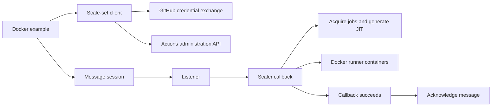

# Go Reference Architecture

This guide records the observed Go reference architecture at commit
`716908e507993947ada4273aecf2361c02e5836c` (updating the earlier
`e6daac702355cdb5b880b4fbdcf6d85dcd9e48e5` baseline with upstream PRs `#130`–`#145`). See the product roadmap and
implementation notes for scaleset.NET design and current status.

## 1) Architectural Style

A reusable HTTP client, a message-session client, and a serial listener are
composed by a provisioning application. Provider policy is separated by the
`listener.Scaler` interface. The source is not a Kubernetes controller.
Demand statistics, separate administration/queue credentials, and acknowledgment
after successful processing shape the architecture.

## 2) System Flow

1. `run` validates flags, creates the client, resolves a runner group, creates
   a scale set, pulls the runner image, and opens a session.
2. On first administration request, App JWT -> installation token (or PAT) ->
   scope registration token -> `RemoteAuth` exchange -> Actions URL/admin JWT.
3. `Listener.Run` passes initial session statistics as synthetic message -1,
   then long-polls with the current maximum capacity.
4. The scaler acquires available job request IDs, handles started/completed
   events, and uses `TotalAssignedJobs` to calculate desired runners.
5. Each new runner gets an encoded JIT config and starts in its own Docker
   container. The example records its name/container ID in memory.
6. Successful callbacks are acknowledged using an uncancelled context.
   Errors terminate the loop without acknowledgment. Caller cleanup closes
   the session, force-removes runners, and deletes the scale set.

## 3) Layer/Module Responsibilities

| Module | Owns | Delegates | Evidence |
|---|---|---|---|
| `Client` | Admin-token refresh, API requests, message parser | Container lifecycle | `client.go` |
| `commonClient` / `http_client.go` | SDK-owned per-request retries, `MaxElapsed`/deadline wait skipping, rate-limit hooks, `WithRequestRetry`, `NewHTTPClient` & HTTP/2 pings | Caller-injected `HTTPClient` transport & business policy | `common_client.go`, `http_client.go` |
| `MessageSessionClient` | Queue token, refresh-on-401, acquisition HTTP, `MessagePollTimeout` per poll attempt | Which jobs to acquire | `session_client.go` |
| `errors.go` | `RequestResponseError` response snapshots, `RateLimitError` (`Primary`/`Secondary`), `MaxElapsedExceededError`, URL redaction | Call-site retry/requeue handling | `errors.go` |
| `Listener` | Ordered callbacks and ack sequencing | Scaling and runner state | `listener/listener.go` |
| Docker `Scaler` | Additive minimum, event handling, container state | HTTP details | `examples/dockerscaleset/scaler.go` |

## 4) Reused Patterns

Functional HTTP options configure shared transport. JWT providers adapt local
PEM keys or external signers. Admin token refresh uses a mutex and a second
validity check; session refresh uses a mutex and a session/token comparison.
The current session is atomically published. Listener interfaces support
mocking, and callbacks never execute concurrently.

## 5) Known Architectural Risks

These are source-derived design considerations, not validated production incidents:

- Source comments can overstate listener session ownership.
- Example runner maps disappear on restart and panic on unknown/replayed names.
- Side effects can partially succeed before the callback fails; replay needs
  idempotent provisioning and cleanup.
- The small runner-reference DTO does not expose per-runner busy state.
  Recovery cannot infer safe deletion from a runner lookup alone.
- Example shutdown force-removes busy runners and deletes scale-set identity.

## 6) Evidence

- [Client/authentication](https://github.com/actions/scaleset/blob/716908e507993947ada4273aecf2361c02e5836c/client.go)
- [HTTP client and retries](https://github.com/actions/scaleset/blob/716908e507993947ada4273aecf2361c02e5836c/http_client.go)
- [Errors and rate limits](https://github.com/actions/scaleset/blob/716908e507993947ada4273aecf2361c02e5836c/errors.go)
- [Session](https://github.com/actions/scaleset/blob/716908e507993947ada4273aecf2361c02e5836c/session_client.go)
- [Listener](https://github.com/actions/scaleset/blob/716908e507993947ada4273aecf2361c02e5836c/listener/listener.go)
- [Docker scaler](https://github.com/actions/scaleset/blob/716908e507993947ada4273aecf2361c02e5836c/examples/dockerscaleset/scaler.go)
- [Runner DTO](https://github.com/actions/scaleset/blob/716908e507993947ada4273aecf2361c02e5836c/types.go)
